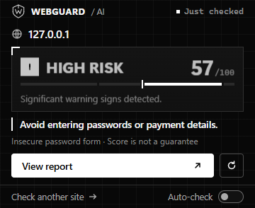
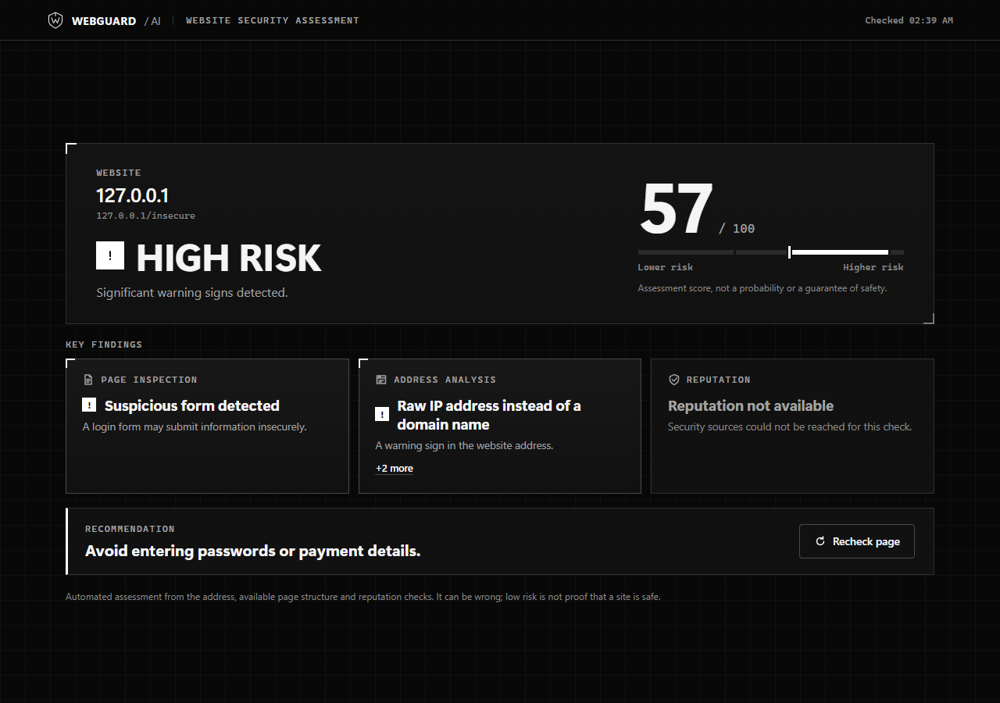
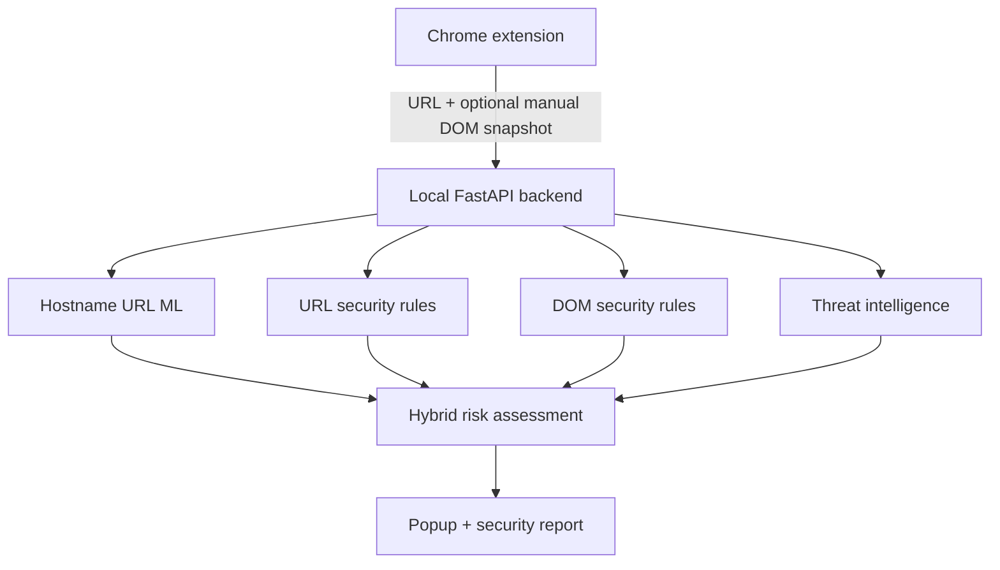

<div align="center">

# WEBGUARD AI
### Understand website risk before you trust it.

A Chrome extension that combines URL-based machine learning, webpage security checks, and threat intelligence to deliver understandable website risk assessments.


[Quick start](#quick-start) · [Architecture](#how-it-works) · [Documentation](#documentation)

</div>

## Your page, explained

**Extension at a glance** — a compact monochrome popup with risk, findings and inspection coverage.



**Detailed website assessment** — the full report brings address, page and reputation evidence into one view.



Real Chrome captures of the current extension and backend inspecting a controlled local fixture with an insecure password form. These are demonstration assessments, not claims about a public website. UI labels and scores are unaltered. [Capture details](docs/assets/README.md).

## Four layers of evidence

| Capability | What it does |
| --- | --- |
| **URL intelligence** | Original XGBoost hostname model plus deterministic address checks. |
| **Page inspection** | Rule-based checks for insecure credential forms and suspicious structural combinations. No DOM machine learning. |
| **Threat reputation** | PhishTank, URLhaus, Google Safe Browsing and a local OpenPhish snapshot; unavailable checks stay explicit. |
| **Understandable assessment** | Hybrid category floors, clear findings, coverage gaps and practical next steps. Optional automatic URL checks and browser notifications. |

Manual inspection collects bounded structure, never input values, passwords, cookies, raw page text or script bodies. Automatic checks are URL-only. Reputation providers may receive the assessed URL; see [privacy](docs/SECURITY_AND_PRIVACY.md).

## How it works



DOM rules can raise risk categories; they never lower URL risk or change the model probability. Confirmed reputation matches retain precedence. [Architecture and source map](docs/ARCHITECTURE.md).

## Quick start

Use Python 3.13 and Chrome. PowerShell:

```powershell
git clone https://github.com/akshat12bhardwaj/WebGuard-AI.git
Set-Location WebGuard-AI
python -m venv .venv
& .\.venv\Scripts\Activate.ps1
python -m pip install -r requirements.txt
if (-not (Test-Path .env)) { Copy-Item .env.example .env }
python -m backend.serve --host 127.0.0.1 --port 8000
```

The original production URL model is included unchanged, so a fresh clone supports inference after dependency installation. [Model provenance and checksum](models/README.md). Optional provider credentials belong only in local `.env`; missing keys and feeds are shown as unavailable.

1. Open `chrome://extensions` and enable **Developer mode**.
2. Choose **Load unpacked** and select `WebGuard-AI/extension`.
3. Open an HTTP(S) page and click the WebGuard toolbar icon to inspect it.
4. Open the full report for details. Enable automatic checks and notifications only if wanted.

No extension build or npm install is required. [Configuration and development](docs/DEVELOPMENT.md).

## Testing

Install Node.js for extension tests. From the repository root:

```powershell
python -m pytest -q
npm --prefix extension test
python -m ruff check backend ml tests extension/scripts
git diff --check
```

[Test guide](docs/TESTING.md) includes real Chrome checks for DOM extraction, navigation, notifications, popup and report layouts. Dataset-dependent and opt-in live-provider tests can skip on a fresh clone. [Verified publication results](docs/PUBLICATION.md).

## Documentation

- [Architecture](docs/ARCHITECTURE.md) and [API contract](docs/API_CONTRACT.md)
- [Development](docs/DEVELOPMENT.md) and [testing](docs/TESTING.md)
- [Security and privacy](docs/SECURITY_AND_PRIVACY.md)
- [DOM evidence schema](docs/DOM_FEATURE_SCHEMA.md)
- [Project status](docs/PROJECT_STATUS.md) and [DOM ML retirement](docs/archive/DOM_ML_RETIREMENT.md)
- [Model provenance](models/README.md) and [AI use disclosure](docs/AI_USE_DISCLOSURE.md)

## Status and responsible use

An implemented local research application, with automated regression and browser verification. Hostname-model bias, provisional hybrid scoring and limited real-world validation remain. This is not a certified or fully validated commercial protection service.

**WebGuard AI provides risk indicators, not a guarantee that a website is safe.**
