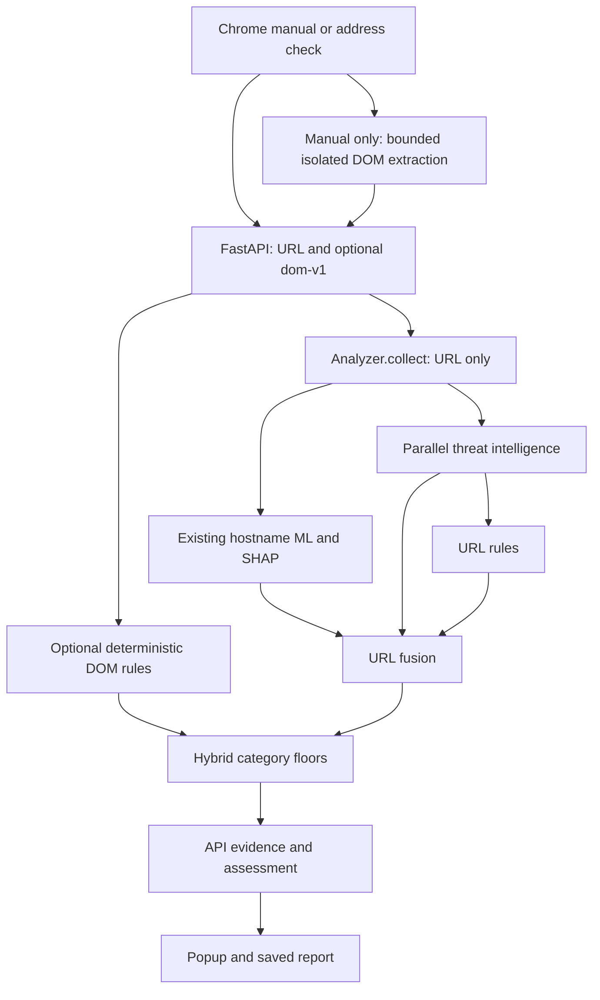

# Architecture

The product uses one existing hostname classifier, deterministic URL and DOM rules, reputation evidence and monotonic hybrid assessment. DOM inspection is rule-based only.

`backend/api.py` creates only `Analyzer` at startup. `backend/service.py` normalizes the address, skips third-party lookups for private/local hosts, collects TI, evaluates the URL model and rules, and returns evidence. It never fetches the assessed page. `ml/predict.py` loads the locally trusted `models/model_bundle.joblib`; `ml/feature_extraction.py` supplies the same hostname features as original training. `backend/fusion.py` retains exact probability thresholds, reliability guards and explicit missing-model behavior.

`backend/dom_schema.py` validates optional bounded `dom-v1` evidence. `backend/dom_rules.py` checks password-form transport, cross-site destinations, hidden fields and credential/refresh combinations. Link/frame/resource aggregates supply context. `backend/hybrid.py` applies only rule category floors: high findings may raise to high risk, medium findings to caution. It never lowers risk, averages probabilities or changes URL probability. Confirmed TI dangerous/95 retains precedence. External HTTPS login and hidden-field informational findings alone do not raise risk. Missing/incompatible DOM preserves URL assessment.

Categories remain `low_risk`, `caution`, `high_risk`, `dangerous`, `unknown`. Unknown has technical placeholder score 50 and null safety score; consumer views show a dash. Missing model evidence without a meaningful rule/TI warning remains unknown. Policy scores are provisional, not validated phishing probabilities.

## Source map

- `backend/serve.py`: local environment loading and server entry point.
- `backend/evidence.py`, `rules.py`, `threat_intel.py`, `openphish_update.py`: evidence, URL rules and reputation/feed handling.
- `extension/background.js`, `assessor.js`: requests, navigation guards, cache, optional automatic URL checks, badges and notifications.
- `extension/dom_extractor.js`, `dom_inspection.js`: manual extraction, privacy bounds, document identity and fallback.
- `extension/api.js`: URL preparation and response validation.
- `extension/consumer.js`, `gauge.js`, `popup.*`, `report.*`, `theme.css`: presentation and workflow animation; `report_model.js` retains technical helpers.

URL cache lasts ten minutes. Structural entries are separate per-tab/document/fingerprint records with a thirty-second maximum; rechecks extract again. URL-only results cannot satisfy structural checks. Navigation and stale asynchronous responses are guarded. Automatic mode never extracts DOM. Workflow motion repeats while visible, pauses offscreen/when hidden, respects reduced motion, and makes no analysis requests.

API version remains 1.0; DOM requests add policy version `url-dom-r2`. `evidence.model` remains the URL model. `evidence.dom` contains only schema/state, rules, summary and optional features; classifier diagnostics are removed. See [API contract](API_CONTRACT.md), [DOM schema](DOM_FEATURE_SCHEMA.md) and [privacy](SECURITY_AND_PRIVACY.md).
